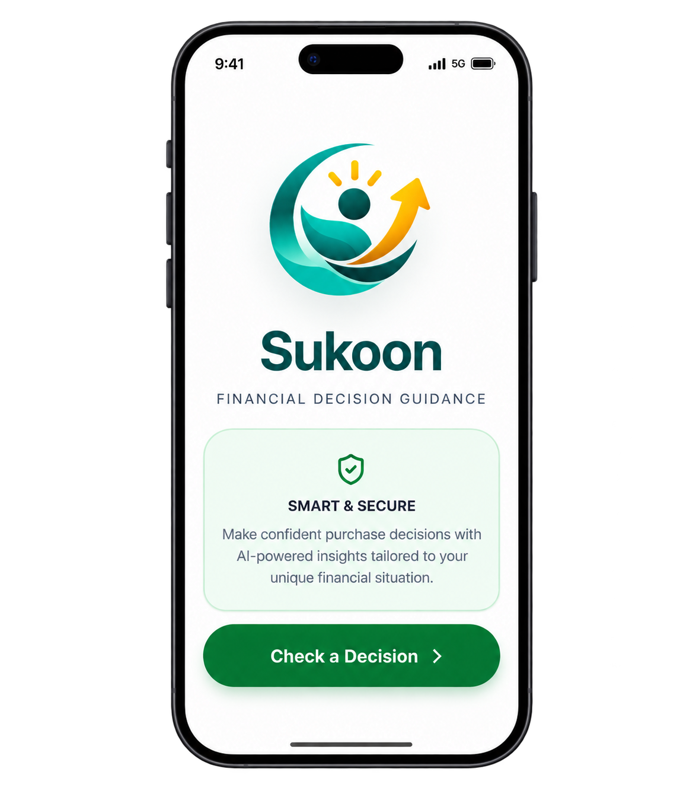

 

# Sukoon

  

Know the "cost" before you commit.

**[Live App](https://sukoooon.vercel.app/)**

## The Problem

When you're about to make a purchase, you feel the weight of the decision but can't see the full picture. You wonder: Is this right for me? Can I afford it now? Will I regret it later?

## Unique Selling Proposition

**Shows its math.** You see exactly how Sukoon arrived at its verdict through a transparent four-lens framework.

**Adapts to you.** Your answers shape how the calculation weighs each dimension. What matters most to you drives the outcome.

**Always leaves a next step.** Even when the verdict is "Wait" or "Don't buy," Sukoon shows you the alternative strategies and when to revisit the decision.

## The Product

Every purchase decision is evaluated through four lenses:

- **Financial**: Can you afford it now? Will it strain your finances?
- **Emotional**: Does this align with what matters to you?
- **Practical**: Will you actually use it? Does it solve a real problem?
- **Future**: Does this move you closer to or further from your goals?

Sukoon applies your chosen mindset—Safety-First, Be Flexible, or Think Ahead—to weight these lenses, then delivers a verdict: **Go**, **Wait**, or **Don't Buy**.

## Mindsets

- **Safety-First**: Prioritize financial stability and low risk.
- **Be Flexible**: Balance all dimensions; adaptability matters.
- **Think Ahead**: Weight long-term impact and goal alignment.

## How It Works

### The Calculation

The evaluation process:

1. **Collect inputs**: Purchase amount, product type, timing, financial situation, personal priorities
2. **Score each lens**: Financial health check, emotional alignment, practical necessity, future goal impact (each scored 0-100)
3. **Apply mindset weights**: Safety-First emphasizes Financial and Future; Be Flexible treats all equally; Think Ahead emphasizes Future and Emotional
4. **Calculate weighted score**: Composite score determines the verdict threshold
5. **Generate explanation**: AI interprets results and suggests next steps or alternatives

**Pure math**: Lens scoring, weighting, and verdict determination.  
**AI-driven**: Contextual explanations, personalized alternatives, and adaptive messaging via Google Gemini.

### Built Features

- One-time purchase and EMI (no-cost and regular) calculations
- Flexible timing input (Today, This Week, This Month, Within 3 Months, Flexible, No Rush)
- Smart Checks (financial health signals derived from your input)
- Alternative strategies when verdict is Wait or Don't Buy
- Instant feedback and next-step recommendations

## Roadmap

- Follow-up after 3 weeks to validate your decision
- Decision history to identify patterns in your choices
- Subscription and recurring purchase support
- Integration with financial accounts for real-time data

## Tech Stack

- **Frontend**: React 19, Vite, TypeScript, Tailwind CSS
- **State Management**: Zustand
- **AI**: Google Gemini API (server-side)
- **Deployment**: Vercel
- **Styling**: Tailwind CSS with custom design tokens

## Contributing

This is a portfolio project. Feedback and suggestions are welcome. To contribute:

1. Fork the repository
2. Create a feature branch (`git checkout -b feature/your-feature`)
3. Commit your changes (`git commit -m 'Add your feature'`)
4. Push to the branch (`git push origin feature/your-feature`)
5. Open a Pull Request

## Author

Surya Gummalla
